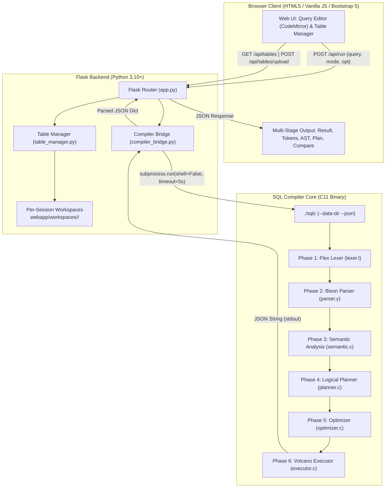

# Web Architecture & Integration Specification

This document details the architectural design and request lifecycle of the **SQL Query Compiler & Optimizer Web Application**.

---

## 1. System Architecture Diagram



---

## 2. End-to-End Request Dataflow

1. **User Request:**
   The user types a SQL query in the CodeMirror editor and presses `Ctrl+Enter` or clicks **Run Query**. The frontend issues a `fetch` request:
   ```http
   POST /api/run HTTP/1.1
   Content-Type: application/json
   Cookie: session=...

   {
     "query": "SELECT s.name, d.dname FROM students s JOIN dept d ON s.dept_id = d.id WHERE s.age > 20;",
     "mode": "result",
     "optimize": true
   }
   ```

2. **Session Identification & Workspace Resolution:**
   - Flask reads or provisions a unique `session_id` UUID in the session cookie.
   - `table_manager.py` resolves the user's workspace path: `webapp/workspaces/<session_id>/`.
   - If visiting for the first time, default sample tables (`students.csv`, `dept.csv`, `courses.csv`, `enrollments.csv`) are copied from `data/`.

3. **Safe Subprocess Dispatch (`compiler_bridge.py`):**
   - Query length is verified ($\le 5,000$ characters).
   - The query is written to a temporary `.sql` file in a secure temp location.
   - `subprocess.run` executes `./sqlc` with `shell=False`:
     ```bash
     ./sqlc --data-dir webapp/workspaces/<session_id>/ --json -f /tmp/tmp_query.sql
     ```
   - Execution is bounded by a **5-second timeout**.

4. **Compiler Execution Pipeline (`sqlc` in C):**
   - **Lexer (Flex):** Scans SQL tokens, tracks exact line and column numbers.
   - **Parser (Bison):** Constructs the Abstract Syntax Tree (AST).
   - **Semantic Analysis:** Validates table and column references against the workspace's CSV schema, resolving types and checking predicates.
   - **Logical Planner:** Generates the relational algebra tree.
   - **Optimizer:** Applies rule-based rewrites to fixed point (Constant Folding, Boolean Simplification, Filter Removal, Predicate Pushdown, Hash Join Conversion).
   - **Executor:** Volcano iterator model pulls tuples on demand.

5. **JSON Serialization:**
   - On success:
     ```json
     {
       "status": "ok",
       "columns": ["s.name", "d.dname"],
       "rows": [["Alice", "CS"], ["Bob", "Math"]],
       "row_count": 2,
       "time_ms": 0.12
     }
     ```
   - On error:
     ```json
     {
       "status": "error",
       "category": "Syntax",
       "message": "syntax error, unexpected FROM (near 'FROM')",
       "line": 1,
       "col": 8
     }
     ```

6. **Browser Rendering (`app.js`):**
   - The frontend updates the active stage tab (Result table, Tokens, AST, Logical Plan, Optimized Plan, or Compare).
   - If an error is returned, the Error Panel displays the error category and message, and highlights the offending line directly inside CodeMirror.

---

## 3. Workspace Isolation Model

```
webapp/workspaces/
├── e1f38a5b-9d21-4f11-b0e2-8b9a10c9201a/   <-- Session A
│   ├── students.csv
│   ├── dept.csv
│   └── custom_customers.csv                <-- Uploaded by Session A
└── 48d91c2e-4b2a-48d1-8172-19e049182a5c/   <-- Session B
    ├── students.csv
    └── dept.csv                            <-- Isolated; Session A's tables unseen
```

- Every session maintains its own private directory of CSV files.
- Path traversal is strictly prohibited: table names must conform to `^[A-Za-z_][A-Za-z0-9_]*$`, and resolved paths are checked against the session directory boundary.
- Workspaces inactive for more than 24 hours are automatically purged on startup.
